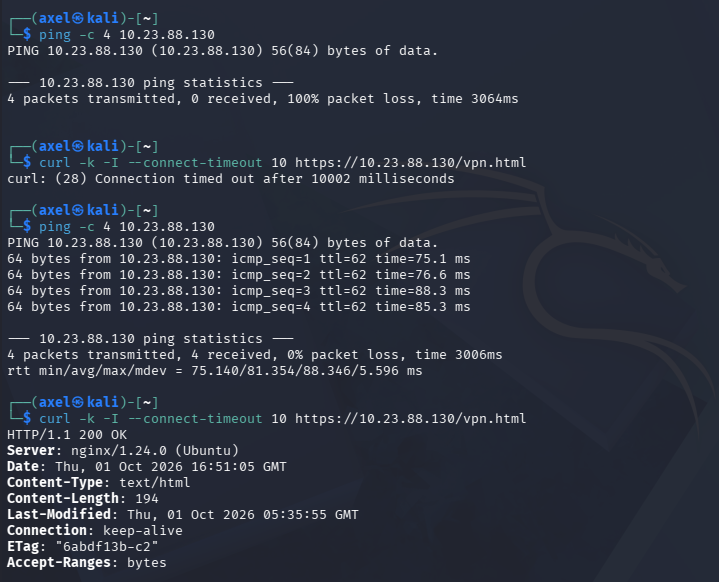
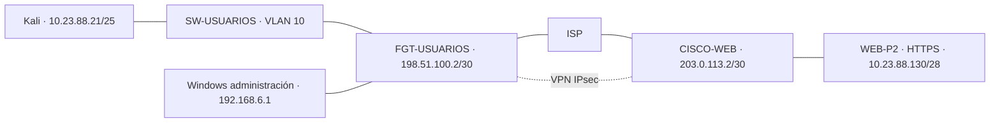
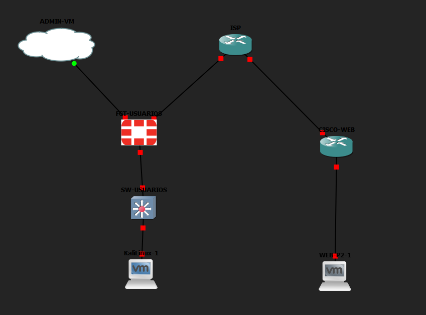

[▶ Ver video: demostración de Infraestructura 2](https://youtu.be/4M8v9ANa0Z8)

# VPN Site-to-Site entre FortiGate y Cisco

**Semana 3 · Práctica 2 · Infraestructura 2**  
**Axel Enrique Vasquez Peña · Matrícula 2024-2388**

## Objetivo de Seguridad de Redes

Comunicar al usuario de la VLAN 10 con el servidor HTTPS mediante una VPN IPsec entre fabricantes diferentes. Comprobar que el acceso deja de funcionar al desactivar el túnel y se recupera al reactivarlo.

La prueba final mostró pérdida total y timeout HTTPS con la VPN desactivada; al reactivarla, ping 4/4 y HTTP 200 OK.

## Topología

## Direccionamiento

| Equipo / interfaz | Dirección | Función |
|---|---|---|
| FortiGate port1 | 192.168.6.137/24, DHCP | Administración |
| FortiGate VLAN10-USUARIOS sobre port2 | 10.23.88.1/25 | Gateway y DHCP de usuarios |
| Kali eth0 | 10.23.88.21/25, DHCP | Usuario |
| FortiGate port3 | 198.51.100.2/30 | WAN |
| ISP Fa0/0 | 198.51.100.1/30 | Enlace a FortiGate |
| ISP Fa0/1 | 203.0.113.1/30 | Enlace a Cisco |
| CISCO-WEB Fa0/0 | 203.0.113.2/30 | WAN y crypto map |
| CISCO-WEB Fa0/1 | 10.23.88.129/28 | Gateway del servidor |
| WEB-P2 ens33 | 10.23.88.130/28 | Servidor HTTPS |

Las redes WAN son rangos de documentación usados para simular direcciones públicas; no representan conectividad pública real a Internet. DHCP de usuarios: 10.23.88.2–10.23.88.126.

## Resultados y evidencias

| Requisito | Resultado observado | Evidencia |
|---|---|---|
| VLAN 10 | Trunk Gi0/0 y acceso Gi0/1 en VLAN 10 | [Switch](02-switch-vlan10.png) |
| DHCP /25 | Kali obtiene 10.23.88.21/25, gateway 10.23.88.1 | [Kali](04-kali-dhcp.png), [GUI DHCP](03-fortigate-vlan-dhcp.png) |
| Servidor /28 | 10.23.88.130/28, gateway 10.23.88.129 | [Servidor](05-servidor-red.png) |
| VPN entre peers | FortiGate Up y Cisco QM_IDLE | [FortiGate](06-vpn-up.png), [Cisco](07-cisco-qm-idle.png) |
| HTTPS | HTTP 200 OK y ping 4/4 | [Acceso](08-https-ping.png) |
| Traceroute | Alcanza 10.23.88.130 | [Recorrido](09-traceroute.png) |
| NAT Cisco | 203.0.113.2:2222 → 10.23.88.130:22 | [Traducciones](10-nat-cisco.png) |
| Dependencia de VPN | Bloqueo sin VPN y recuperación al habilitarla | [Prueba final](11-vpn-bloqueo-recuperacion.png) |
| NAT FortiGate | 192.168.6.1 → 198.51.100.2 | [Registro GUI](12-nat-fortigate.png) |

## Documentación

- [Configuración de FortiGate por GUI](CONFIGURACION-GUI.md)
- [Pruebas, comandos y resultados](PRUEBAS.md)
- [Fragmento reconstruido de CISCO-WEB, sin clave](CISCO-WEB.cfg)
- [Fragmento reconstruido del ISP](ISP.cfg)
- [Fragmento reconstruido del switch](SW-USUARIOS.cfg)
- [Página de prueba HTTPS](vpn.html)

Los archivos `.cfg` son fragmentos reconstruidos a partir de la configuración realizada; no son exportaciones completas de los equipos. No se incluyen claves, contraseñas, imágenes de máquinas virtuales ni un proyecto GNS3 exportado. FortiGate se configuró y se demostró por GUI; Cisco y Linux se verificaron por consola.

## Alcance y limitaciones

La demostración de aislamiento se refiere al usuario Kali accediendo al servidor. Existe un flujo separado de administración desde Windows: FortiGate aplica SNAT y Cisco publica SSH mediante TCP/2222. Ese flujo sirve para demostrar NAT en ambos equipos y no depende del túnel. La política de usuario solo permite HTTPS y PING por VPN, sin NAT.

Se utilizó DES/SHA1 por compatibilidad con el laboratorio y su FortiGate de evaluación; no es una propuesta criptográfica para producción. `curl -k` omite la validación del certificado de laboratorio.

Durante las pruebas se produjo una interrupción de tráfico con el túnel aparentemente activo. Renovar las asociaciones IPsec no la resolvió; un reinicio del FortiGate restauró el tráfico. Después se repitió con éxito el ciclo de desactivar y reactivar la VPN, sin otro reinicio. La causa exacta de la incidencia no quedó determinada.
